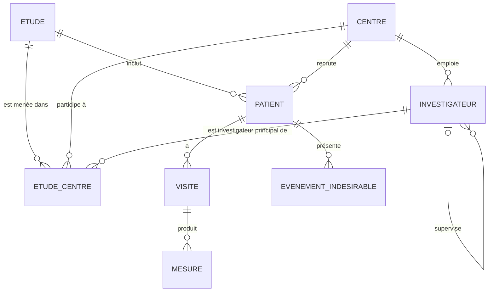

# Plan de la formation « Langage SQL »

> Formation préparant à la certification **RS7205 – Langage SQL : Exploiter une base de données relationnelle** (certificateur : Éditions ENI).
> Durée de référence : 35 h (e-learning, présentiel, accompagnement individuel).

---

## 0. Principes directeurs

| Constat | Conséquence sur le cours |
|---|---|
| L'examen ENI porte sur le **SQL standard**, sans SGBD particulier | On pratique sur **MySQL 8**, mais chaque chapitre contient un encadré **« Standard vs MySQL »** (`FULL OUTER JOIN`, `FETCH FIRST n ROWS`, `SELECT … INTO`…). |
| L'examen = **cas pratiques + QCM/QCU** | Chaque chapitre se termine par un mini-quiz au format examen ; un module final de type examen blanc. |
| Public visé par la certification : profils **non informaticiens** qui exploitent des données (responsables métier, chefs de projet, data analysts, contrôleurs de gestion, RH, CRM…) | Exemples orientés **extractions, indicateurs et KPI**, vocabulaire accessible. |
| Une grande partie de la formation se fait **en autonomie** (e-learning) | Le support doit être **autoportant** : il sert aussi bien au stagiaire qu'au formateur. |
| Salles de formation **non équipées** | Chaque stagiaire vient avec son ordinateur ; l'installation (MySQL + DBeaver) est la toute première étape pratique. |
| Le programme cite « INTO » et « tables temporaires » | MySQL ne connaît pas `SELECT … INTO nouvelle_table` : on enseigne la forme standard **et** les équivalents MySQL (`CREATE TABLE … AS SELECT`, `INSERT INTO … SELECT`, `CREATE TEMPORARY TABLE`). |

**Outils :** MySQL 8 (serveur) + DBeaver Community (client graphique).

---

## 1. La base d'entraînement unique : `essais_cliniques`

Tous les exemples et exercices de la formation utilisent **la même base**, entièrement **fictive**.
Thème : le suivi d'essais cliniques (études, centres, patients, visites, événements indésirables). Ce domaine fournit naturellement des dates, des valeurs manquantes, des relations N–N et des indicateurs concrets (taux de recrutement, visites manquées, sécurité), donc des exemples riches pour tous les chapitres.

> 📖 Que représentent ces tables, et qui sont les acteurs ? → [**Comprendre la base**](db/comprendre-la-base.md) (le domaine expliqué simplement).



| Table | Colonnes principales | Concepts illustrés |
|---|---|---|
| `etude` | code, titre, phase, aire_therapeutique, date_debut, objectif_inclusions, statut | Filtres simples, dates |
| `centre` | nom, ville, pays | Jointures, regroupements par pays |
| `investigateur` | nom, prenom, specialite, centre_id, superviseur_id | Auto-jointure |
| `etude_centre` | etude_id, centre_id, pi_id, date_ouverture, objectif_inclusions | Association N–N, clé composée |
| `patient` | code_patient, etude_id, centre_id, sexe, annee_naissance, date_screening, date_inclusion (NULL = échec de screening), bras, date_sortie, motif_sortie | `IS NULL`, `CASE`, KPI de recrutement |
| `visite` | patient_id, type_visite (V0…V6), date_prevue, date_realisee (NULL = visite manquée) | `LEFT JOIN`, taux d'observance, calculs de dates |
| `evenement_indesirable` | patient_id, date_survenue, terme, grade (1–5), grave (oui/non), lien_traitement | Agrégats, `HAVING`, sous-requêtes |
| `mesure` | visite_id, parametre, valeur, unite | `AVG`, `MIN`, `MAX`, évolutions |

**Anomalies volontaires** : un centre sans patient, une étude pas encore ouverte, des valeurs NULL, un investigateur sans étude… indispensables pour rendre `LEFT JOIN`, `IS NULL` et `NOT EXISTS` parlants.

Les données sont produites par un **script de génération déterministe** : même résultat à chaque exécution, et la base peut évoluer au fil du cours sans incohérence (historique dans `db/CHANGELOG.md`).

---

## 2. Gabarit de chaque chapitre

```
1. Objectif        → ce que vous saurez faire (1–2 lignes)
2. Concept         → explication en langage clair
3. Visuel          → schéma texte ou Mermaid
4. Exemples        → 3–5 requêtes commentées sur essais_cliniques + résultat attendu
5. À vous          → 3–6 exercices progressifs (corrigés dans exercices/solutions/)
6. Pièges          → erreurs fréquentes + encadré « Standard vs MySQL »
7. Quiz            → 5 questions au format QCM/QCU de l'examen
8. Côté métier     → à quoi ça sert concrètement (extraction, indicateur, KPI)
```

Exemple de visuel texte (`LEFT JOIN`) :

```
 centre (gauche)          patient (droite)            Résultat LEFT JOIN
 ┌────┬─────────┐        ┌────┬───────────┐        ┌─────────┬───────────┐
 │ id │ nom     │        │ id │ centre_id │        │ nom     │ patient.id│
 ├────┼─────────┤        ├────┼───────────┤        ├─────────┼───────────┤
 │ 1  │ Tours   │◄──────►│ 10 │ 1         │   →    │ Tours   │ 10        │
 │ 2  │ Nantes  │◄──────►│ 11 │ 2         │        │ Nantes  │ 11        │
 │ 3  │ Brest   │   ✗    │    │           │        │ Brest   │ NULL  ◄── conservé quand même
 └────┴─────────┘        └────┴───────────┘        └─────────┴───────────┘
```

---

## 3. Déroulé de la formation

### Module 0 – Accueil et positionnement (≈ 1 h)
- Questionnaire de positionnement + quelques requêtes pour situer le niveau
- Recueil des besoins métier de chaque stagiaire (extractions, indicateurs utilisés)
- Check-list : installer MySQL 8 + DBeaver avant la première séance

### Module 1 – Concepts fondamentaux (≈ 3 h)
- 1.1 Qu'est-ce qu'une base de données : table, ligne, colonne, valeur — parallèle avec un classeur Excel
- 1.2 SGBD / SGBDR, architecture client-serveur, familles d'instructions SQL (DDL, DML, DQL, DCL)
- 1.3 Installation de MySQL et DBeaver, connexion au serveur
- 1.4 Chargement de `essais_cliniques` (exécution d'un script .sql), exploration (`SHOW TABLES`, `DESCRIBE`), premier `SELECT *`

### Module 2 – Modélisation et intégrité (≈ 5 h)
- 2.1 Types de données : numériques (`INT`, `DECIMAL`), texte (`CHAR`, `VARCHAR`), dates (`DATE`, `DATETIME`), booléen ; la notion de `NULL`
- 2.2 Du MCD (entités-associations, cardinalités) au MLD puis au MPD, construit pas à pas sur notre base
- 2.3 Clés et contraintes : `PRIMARY KEY`, `FOREIGN KEY`, `UNIQUE`, `NOT NULL`, `CHECK`, `DEFAULT` ; `ON DELETE` / `ON UPDATE`
- 2.4 `CREATE TABLE`, `ALTER TABLE`, `DROP TABLE` — et pourquoi une contrainte refuse une insertion
- 2.5 Normalisation « légère » : pourquoi on ne met pas tout dans un seul grand tableau
- 2.6 Sauvegarde et restauration : `mysqldump`, réimport, script de réinitialisation de la base

### Module 3 – Requêtes simples (mono-table) (≈ 8 h)
- 3.1 `SELECT` : colonnes, alias, colonnes calculées, `DISTINCT`
- 3.2 `WHERE` : comparaisons, `AND` / `OR` / `NOT` et priorités, `BETWEEN`, `IN`, `LIKE`, `IS NULL`
- 3.3 `ORDER BY`, limitation des résultats (`LIMIT` vs `FETCH FIRST` standard)
- 3.4 Fonctions utiles : texte (`CONCAT`, `UPPER`, `SUBSTRING`), dates (`YEAR`, `DATEDIFF`, calculs), `CASE WHEN`, `COALESCE`
- 3.5 Agrégats : `COUNT(*)` vs `COUNT(colonne)`, `SUM`, `AVG`, `MIN`, `MAX` et le traitement des NULL
- 3.6 `GROUP BY` et `HAVING`
- 3.7 Ordre logique d'exécution : FROM → WHERE → GROUP BY → HAVING → SELECT → ORDER BY
- 3.8 Sous-requêtes : scalaire, `IN`, `EXISTS` / `NOT EXISTS`, dans le `FROM`
- Côté métier : inclusions par centre, taux d'échec de screening, âge moyen par bras, nombre d'événements graves par étude

### Module 4 – Requêtes complexes multi-tables (≈ 8 h)
- 4.1 Pourquoi joindre : clé primaire ↔ clé étrangère
- 4.2 `INNER JOIN`, puis jointures sur 3–4 tables
- 4.3 `LEFT` / `RIGHT OUTER JOIN` : trouver ce qui manque (centres sans patient, visites manquées)
- 4.4 `FULL OUTER JOIN` (standard) et son émulation MySQL avec `UNION`
- 4.5 Auto-jointure (investigateur → superviseur), `CROSS JOIN` (grille des visites attendues)
- 4.6 Alias de tables ; `UNION` vs `UNION ALL`
- 4.7 Tables temporaires, `SELECT … INTO` (standard) ↔ `CREATE TABLE … AS SELECT` / `INSERT INTO … SELECT` (MySQL)
- 4.8 Bonus : les CTE (`WITH …`) pour découper un indicateur complexe en étapes

### Module 5 – Mise à jour des données (≈ 3 h)
- 5.1 `INSERT` (une ligne, plusieurs lignes, `INSERT … SELECT`)
- 5.2 `UPDATE` avec `WHERE`, y compris avec sous-requête
- 5.3 `DELETE` et `TRUNCATE` ; effet des clés étrangères
- 5.4 Filet de sécurité : transactions (`START TRANSACTION` / `ROLLBACK` / `COMMIT`), toujours tester le `SELECT` avant l'`UPDATE`

### Module 6 – Création de vues (≈ 3 h)
- 6.1 Qu'est-ce qu'une vue (vs table, avantages)
- 6.2 `CREATE VIEW` simple, `CREATE OR REPLACE VIEW`, `DROP VIEW`
- 6.3 Vues complexes (jointures + agrégats) comme couche d'indicateurs, vues sur vues, vues modifiables et `WITH CHECK OPTION`
- 6.4 Les filtres `LIKE` / `IN` / `IS NULL` / `BETWEEN` appliqués aux vues
- **Fil rouge** : construire un jeu de vues `v_tableau_de_bord_*` (recrutement, observance des visites, sécurité) exploitables depuis Excel

### Module 7 – Préparation à la certification et bonus (≈ 5 h)
- 7.1 L'examen en bref, conseils
- 7.2 Fiche de synthèse (syntaxe, « SQL standard vs MySQL », 10 pièges)
- 7.3 Examen blanc : cas pratique + 30 questions QCM/QCU
- 7.4 Bonus : fonctions de fenêtrage (`ROW_NUMBER`, `RANK`, cumul, `LAG`)
- 7.5 Bonus : tableau croisé en SQL (agrégat conditionnel)
- 7.6 Bonus : export CSV / Excel, connexion ODBC, requête depuis VBA
- 7.7 Préparer ses données pour Excel et Power BI : Power Query, pièges du CSV (dates, décimales, encodage), export XLSX, connexion directe à une vue, format long vs large, où calculer les KPI

---

## 4. Organisation du dépôt

```
formation-sql/
├── README.md
├── PLAN.md                  ← ce document
├── db/
│   ├── essais_cliniques.sql ← LE script à charger (schéma + données ; le relancer = remise à zéro)
│   ├── 01_schema.sql        ← CREATE TABLE commentés
│   ├── 02_data.sql          ← données générées
│   ├── generate_data.py     ← générateur déterministe
│   ├── README.md            ← le domaine expliqué + schéma
│   └── CHANGELOG.md         ← évolutions du schéma
├── cours/
│   ├── 00-accueil.md
│   ├── 01-concepts.md … 07-certification.md
├── exercices/
│   └── solutions/
├── quiz/                    ← examen blanc + corrigé
└── outils/
    └── resultats.py         ← recalcule les « résultats attendus » du cours à partir de la base
```
