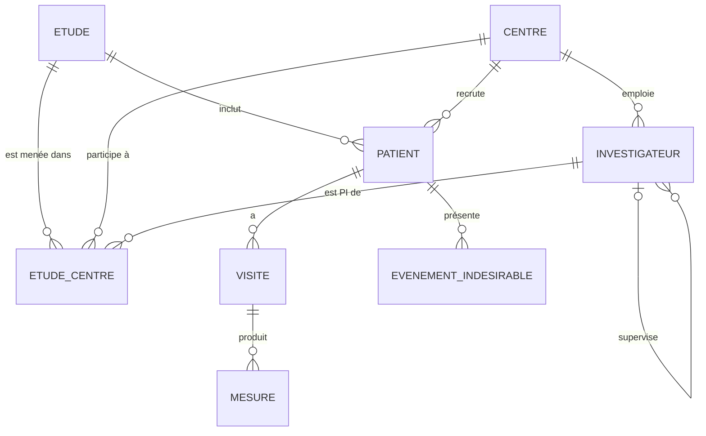

# Module 1 — Concepts fondamentaux

> **Objectif** : comprendre comment une base de données relationnelle est organisée, ce qu'est un SGBD, et savoir explorer une base inconnue.
> **Durée indicative** : 3 h

---

## 1.1 Qu'est-ce qu'une base de données ?

### Concept

Une **base de données** est un ensemble organisé d'informations, stockées de façon à pouvoir être **retrouvées, combinées et mises à jour** facilement, par plusieurs personnes à la fois, sans incohérence.

Dans une base **relationnelle**, les informations sont rangées dans des **tables** :

| Terme | Définition | Équivalent Excel |
|---|---|---|
| **Table** | Ensemble d'informations sur un même type d'objet (des patients, des centres…) | Une feuille |
| **Colonne** (ou champ, attribut) | Une caractéristique, avec un **type** fixé (nombre, texte, date…) | Une colonne… mais typée |
| **Ligne** (ou enregistrement, tuple) | Un objet précis (un patient donné) | Une ligne |
| **Valeur** | Le contenu d'une case | Une cellule |
| **Clé primaire** | Colonne(s) qui identifie(nt) chaque ligne de façon **unique** | (n'existe pas vraiment) |
| **Clé étrangère** | Colonne qui fait **référence** à la clé primaire d'une autre table | Une RECHERCHEV… mais garantie |

### Visuel — une table

```
                         Table : centre
              ┌────┬─────────────────────────┬─────────┬────────┐
  en-tête  →  │ id │ nom                     │ ville   │ pays   │  ← colonnes
              ├────┼─────────────────────────┼─────────┼────────┤
              │ 1  │ Clinique du Val de Loire│ Tours   │ France │  ← une ligne
              │ 2  │ CHU Atlantique          │ Nantes  │ France │
              │ 6  │ Clinique du Léman       │ Genève  │ Suisse │
              └────┴─────────────────────────┴─────────┴────────┘
                ▲                                         ▲
          clé primaire                               une valeur
     (jamais deux fois la même)
```

### Base de données vs classeur Excel

| | Classeur Excel | Base de données relationnelle |
|---|---|---|
| Structure | Libre : on peut tout mélanger dans une colonne | Stricte : chaque colonne a un **type** et des **règles** |
| Volume | Lent au-delà de quelques centaines de milliers de lignes | Des millions de lignes sans difficulté |
| Plusieurs utilisateurs | Conflits, fichiers « v2_final_OK.xlsx » | Accès simultané géré par le serveur |
| Liens entre tableaux | RECHERCHEV fragiles | **Clés étrangères** contrôlées par le système |
| Interrogation | Filtres, TCD, formules, VBA | Le **langage SQL** |
| Cohérence | Rien n'empêche une faute de frappe | **Contraintes d'intégrité** (module 2) |

> 💡 Excel reste un excellent outil de **présentation**. Le schéma classique en entreprise : les données vivent dans une base, on les **extrait en SQL**, puis on les met en forme dans Excel ou un outil de tableau de bord.

### Pourquoi plusieurs tables ?

Imaginons qu'on stocke tout dans un seul grand tableau :

```
┌──────────────┬───────────┬──────────────────────────┬────────┬───────────────────┐
│ code_patient │ etude     │ centre                   │ ville  │ promoteur         │
├──────────────┼───────────┼──────────────────────────┼────────┼───────────────────┤
│ CARDIO-01-…1 │ CARDIO-01 │ Clinique du Val de Loire │ Tours  │ Laboratoires Alvéa│
│ CARDIO-01-…2 │ CARDIO-01 │ Clinique du Val de Loire │ Tours  │ Laboratoires Alvéa│
│ CARDIO-01-…3 │ CARDIO-01 │ Clinique du Val de Loir  │ Tour   │ Labo Alvea        │ ← 😱
└──────────────┴───────────┴──────────────────────────┴────────┴───────────────────┘
```

- Les mêmes informations sont **répétées** des centaines de fois (place perdue).
- Une faute de frappe crée une **incohérence** : « Tour » et « Tours » sont-elles la même ville ?
- Si le centre change de nom, il faut modifier **toutes** les lignes.

La solution relationnelle : **chaque information n'est stockée qu'une seule fois**, dans sa table, et on fait le lien par une **clé** :

```
 patient                                     centre
┌────┬──────────────┬───────────┐          ┌────┬──────────────────────────┬───────┐
│ id │ code_patient │ centre_id │─────────►│ id │ nom                      │ ville │
├────┼──────────────┼───────────┤          ├────┼──────────────────────────┼───────┤
│ 1  │ CARDIO-01-…1 │ 1         │──┐       │ 1  │ Clinique du Val de Loire │ Tours │
│ 2  │ CARDIO-01-…2 │ 1         │──┤──────►│ 2  │ CHU Atlantique           │ Nantes│
│ 3  │ CARDIO-01-…3 │ 1         │──┘       └────┴──────────────────────────┴───────┘
└────┴──────────────┴───────────┘
                         ▲
              clé étrangère : « le centre n° 1 »
```

Le nom du centre n'est écrit qu'**une fois**. Pour réafficher l'information complète, on **joint** les tables (module 4).

---

## 1.2 SGBD, SGBDR et langage SQL

### Concept

- **SGBD** (Système de Gestion de Bases de Données) : le logiciel qui stocke les données, les protège, gère les accès simultanés et exécute les requêtes.
- **SGBDR** : un SGBD **relationnel** (données en tables reliées par des clés). Exemples : **MySQL**, MariaDB, PostgreSQL, Oracle, SQL Server, SQLite.
- **SQL** (*Structured Query Language*) : le langage **normalisé** (norme ISO/ANSI) commun à tous les SGBDR. Chaque éditeur y ajoute quelques particularités (les « dialectes »).

### Visuel — architecture client / serveur

```
  POSTE DE L'UTILISATEUR                          SERVEUR
 ┌───────────────────────┐                ┌──────────────────────────────┐
 │  DBeaver, Excel,      │   requête SQL  │  SGBD (MySQL)                │
 │  Power BI, un site    │ ─────────────► │   1. vérifie les droits      │
 │  web, une appli…      │                │   2. analyse la requête      │
 │                       │ ◄───────────── │   3. lit/écrit les fichiers  │
 │  = le CLIENT          │    résultat    │   4. renvoie le résultat     │
 └───────────────────────┘                │  ┌────────┐ ┌────────┐       │
                                          │  │ base A │ │ base B │ …     │
                                          │  └────────┘ └────────┘       │
                                          └──────────────────────────────┘
```

Un même serveur héberge **plusieurs bases** ; une base contient **plusieurs tables**. On ne touche jamais aux fichiers directement : on passe **toujours** par le SGBD, en SQL.

### Les familles d'instructions SQL

| Famille | Rôle | Instructions | Module |
|---|---|---|---|
| **LDD / DDL** (définition) | Créer et modifier la **structure** | `CREATE`, `ALTER`, `DROP` | 2, 6 |
| **LMD / DML** (manipulation) | Ajouter, modifier, supprimer des **lignes** | `INSERT`, `UPDATE`, `DELETE` | 5 |
| **LID / DQL** (interrogation) | **Lire** les données | `SELECT` | 3, 4 |
| **LCD / DCL** (contrôle) | Gérer les **droits** | `GRANT`, `REVOKE` | — |
| **TCL** (transactions) | Valider / annuler un ensemble de modifications | `COMMIT`, `ROLLBACK` | 5 |

> 💡 Dans la vie d'un analyste, **90 % du temps se passe en `SELECT`**. C'est pourquoi les modules 3 et 4 sont les plus longs.

### Règles d'écriture

- Une instruction se termine par un **point-virgule** `;`.
- Les **mots-clés** (`SELECT`, `FROM`…) ne sont pas sensibles à la casse ; par convention on les écrit en MAJUSCULES.
- Les **chaînes de caractères** s'écrivent entre **apostrophes simples** : `'France'`. Pour une apostrophe dans le texte, on la double : `'fin d''étude'`.
- Les **dates** s'écrivent comme des chaînes au format `'AAAA-MM-JJ'` : `'2026-06-30'`.
- Les **commentaires** : `-- jusqu'à la fin de la ligne` ou `/* sur plusieurs lignes */`.
- Les espaces et retours à la ligne sont libres : **indentez** pour être lisible.

---

## 1.3 Explorer une base inconnue

### Concept

Face à une base que l'on ne connaît pas, on commence toujours par **la cartographier** : quelles tables ? quelles colonnes ? quels types ? quelques lignes d'exemple ?

### Exemples

**Lister les tables** (instruction propre à MySQL) :

```sql
SHOW TABLES;
```

```text
+----------------------------+
| Tables_in_essais_cliniques |
+----------------------------+
| centre                     |
| etude                      |
| etude_centre               |
| evenement_indesirable      |
| investigateur              |
| mesure                     |
| patient                    |
| visite                     |
+----------------------------+
8 lignes
```

**Décrire une table** (propre à MySQL ; dans DBeaver, double-cliquer sur la table → onglet *Colonnes* donne la même chose) :

```sql
DESCRIBE etude;
```

```text
+---------------------+--------------+------+-----+----------------+----------------+
| Field               | Type         | Null | Key | Default        | Extra          |
+---------------------+--------------+------+-----+----------------+----------------+
| id                  | int          | NO   | PRI | NULL           | auto_increment |
| code                | varchar(20)  | NO   | UNI | NULL           |                |
| titre               | varchar(200) | NO   |     | NULL           |                |
| phase               | varchar(3)   | NO   |     | NULL           |                |
| aire_therapeutique  | varchar(50)  | NO   |     | NULL           |                |
| promoteur           | varchar(100) | NO   |     | NULL           |                |
| date_debut          | date         | YES  |     | NULL           |                |
| date_fin_prevue     | date         | YES  |     | NULL           |                |
| objectif_inclusions | int          | NO   |     | NULL           |                |
| statut              | varchar(20)  | NO   |     | en préparation |                |
+---------------------+--------------+------+-----+----------------+----------------+
```

On y lit : le **type** de chaque colonne, si elle accepte l'absence de valeur (**Null**), si c'est une **clé** (`PRI` = primaire, `UNI` = unique, `MUL` = clé étrangère / index), la valeur **par défaut**.

**La méthode standard** : interroger le dictionnaire de données `INFORMATION_SCHEMA` (présent dans MySQL, PostgreSQL, SQL Server…) :

```sql
SELECT table_name, table_rows
FROM information_schema.tables
WHERE table_schema = 'essais_cliniques';
```

**Voir le contenu d'une table** : `SELECT *` (« toutes les colonnes ») :

```sql
SELECT * FROM centre;
```
<!-- resultat -->
```text
+----+-----------------------------+-------------+----------+
| id | nom                         | ville       | pays     |
+----+-----------------------------+-------------+----------+
| 1  | Clinique du Val de Loire    | Tours       | France   |
| 2  | CHU Atlantique              | Nantes      | France   |
| 3  | Hôpital Saint-Roch          | Montpellier | France   |
| 4  | Centre Hospitalier du Rhône | Lyon        | France   |
| 5  | Clinique des Flandres       | Lille       | France   |
| 6  | Clinique du Léman           | Genève      | Suisse   |
| 7  | Hospital del Sol            | Valencia    | Espagne  |
| 8  | Centre Médical des Ardennes | Liège       | Belgique |
+----+-----------------------------+-------------+----------+
8 lignes
```
<!-- /resultat -->

```sql
SELECT * FROM etude;
```
<!-- resultat -->
```text
+----+-----------+-------------------------------------------------------------+-------+--------------------+--------------------+------------+-----------------+---------------------+----------------+
| id | code      | titre                                                       | phase | aire_therapeutique | promoteur          | date_debut | date_fin_prevue | objectif_inclusions | statut         |
+----+-----------+-------------------------------------------------------------+-------+--------------------+--------------------+------------+-----------------+---------------------+----------------+
| 1  | CARDIO-01 | Effet de la molécule KX-12 sur l'hypertension artérielle    | III   | Cardiologie        | Laboratoires Alvéa | 2024-03-01 | 2026-12-31      | 120                 | suivi          |
| 2  | DIAB-02   | Contrôle glycémique par GL-7 chez le diabétique de type 2   | II    | Diabétologie       | Biomédix           | 2025-01-15 | 2027-06-30      | 80                  | recrutement    |
| 3  | ONCO-03   | Tolérance de l'immunothérapie OX-3 dans le cancer du poumon | II    | Oncologie          | Laboratoires Alvéa | 2025-06-01 | 2027-12-31      | 60                  | recrutement    |
| 4  | NEURO-04  | Première administration de NR-1 chez le volontaire sain     | I     | Neurologie         | NeuroPharm         | 2023-01-10 | 2023-12-31      | 30                  | terminée       |
| 5  | DERM-05   | Efficacité de la crème DM-5 dans le psoriasis               | III   | Dermatologie       | Biomédix           | NULL       | NULL            | 100                 | en préparation |
+----+-----------+-------------------------------------------------------------+-------+--------------------+--------------------+------------+-----------------+---------------------+----------------+
5 lignes
```
<!-- /resultat -->

Remarquez la dernière étude : `date_debut` vaut **NULL**. `NULL` n'est ni zéro ni une chaîne vide : c'est **l'absence de valeur** (« inconnu / pas encore renseigné »). Ici : l'étude n'a pas encore démarré. Les NULL seront au cœur de nombreux pièges (modules 3 et 4).

**Choisir ses colonnes** :

```sql
SELECT code, phase, statut FROM etude;
```
<!-- resultat -->
```text
+-----------+-------+----------------+
| code      | phase | statut         |
+-----------+-------+----------------+
| CARDIO-01 | III   | suivi          |
| DIAB-02   | II    | recrutement    |
| ONCO-03   | II    | recrutement    |
| NEURO-04  | I     | terminée       |
| DERM-05   | III   | en préparation |
+-----------+-------+----------------+
5 lignes
```
<!-- /resultat -->

---

## 1.4 Lire le schéma de la base

### Visuel



Comment lire les extrémités des traits :

```
  ||    exactement un            ETUDE ||--o{ PATIENT
  |o    zéro ou un               se lit dans les deux sens :
  o{    zéro, un ou plusieurs     • une étude a zéro, un ou plusieurs patients
  |{    un ou plusieurs           • un patient appartient à exactement une étude
```

> 💡 Dans DBeaver : clic droit sur la base → **Afficher le diagramme** (onglet *ER Diagram*) dessine ce schéma automatiquement à partir des clés étrangères.

---

## À vous

👉 Exercices : [`exercices/01-concepts.md`](../exercices/01-concepts.md)

---

## Pièges

- **Oublier de sélectionner la base** : l'erreur `No database selected` signifie que DBeaver ne sait pas dans quelle base chercher. Sélectionnez `essais_cliniques` dans la barre de l'éditeur, ou exécutez `USE essais_cliniques;`.
- **Guillemets** : `'France'` (apostrophes) désigne une **valeur texte** ; en SQL standard, `"pays"` (guillemets doubles) désigne un **nom de colonne**. MySQL accepte les deux pour du texte, mais prenez l'habitude des apostrophes.
- **`SELECT *` en production** : pratique pour explorer, mais dans une extraction réelle, listez les colonnes utiles (résultat plus lisible, plus rapide, et qui ne casse pas si on ajoute une colonne).
- **NULL ≠ 0 ≠ ''** : une valeur manquante n'est pas une valeur nulle.

> ### ⚖️ Standard vs MySQL
> | Besoin | SQL standard | MySQL |
> |---|---|---|
> | Lister les tables | `SELECT table_name FROM information_schema.tables` | `SHOW TABLES` (aussi) |
> | Décrire une table | `information_schema.columns` | `DESCRIBE t` / `SHOW COLUMNS FROM t` |
> | Délimiter un nom de colonne | `"nom"` | `` `nom` `` (accent grave) |
> | Changer de base | (pas de notion de « base » unique : schémas) | `USE essais_cliniques` |

---

## Quiz

1. Que garantit une **clé primaire** ?
   - a) Que la colonne est numérique
   - b) Que chaque ligne est identifiable de façon unique et que la valeur n'est jamais absente
   - c) Que la table est reliée à une autre table
   - d) Que la colonne est triée

2. Quelle famille d'instructions contient `SELECT` ?
   - a) LDD  - b) LMD  - c) LID (interrogation)  - d) LCD

3. Que représente `NULL` dans la colonne `date_debut` ?
   - a) La date 0000-00-00  - b) Une chaîne vide  - c) L'absence de valeur  - d) Une erreur de saisie

4. Une **clé étrangère** `patient.centre_id` :
   - a) Identifie de façon unique un patient
   - b) Fait référence à la clé primaire de la table `centre`
   - c) Empêche deux patients d'être dans le même centre
   - d) Est obligatoirement de type texte

5. Laquelle de ces affirmations est vraie ?
   - a) SQL est un langage propre à MySQL
   - b) Le client (DBeaver) stocke les données
   - c) SQL est normalisé, chaque SGBD y ajoute des particularités
   - d) Les mots-clés SQL doivent être écrits en majuscules

<details>
<summary>Réponses</summary>

1. **b** — unicité + non-nullité. 2. **c**. 3. **c**. 4. **b**. 5. **c** — les majuscules ne sont qu'une convention.
</details>

---

## Côté métier

Avant d'écrire la moindre requête sur une base de votre entreprise, faites ce que nous venons de faire :
1. lister les tables, 2. regarder les colonnes et leurs types, 3. afficher quelques lignes, 4. repérer les **clés** (comment les tables se relient) et les colonnes souvent **NULL**.

Demandez aussi s'il existe un **dictionnaire de données** ou un schéma : c'est souvent le document le plus précieux pour un analyste.

---

⬅️ [Module 0](00-accueil.md) · ➡️ [Module 2 — Modélisation et intégrité](02-modelisation.md)
