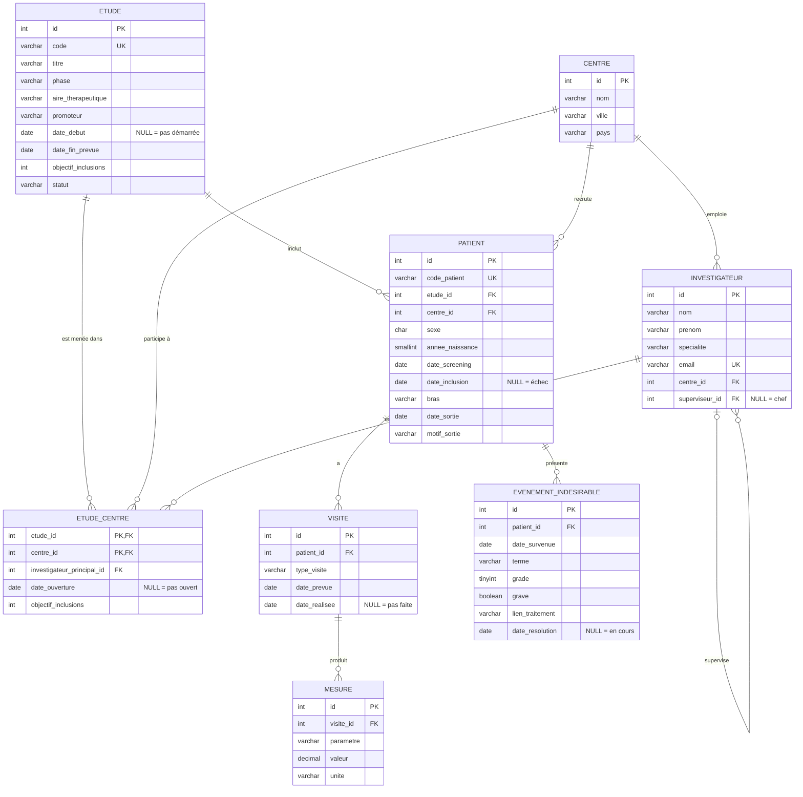

# La base d'entraînement `essais_cliniques`

Toute la formation s'appuie sur cette base. Les données sont **entièrement fictives** (centres, médecins, patients, laboratoires et molécules inventés).

## Installation en 1 minute

1. Ouvrir DBeaver et se connecter au serveur MySQL local.
2. Menu **Fichier → Ouvrir un fichier…** → choisir `db/essais_cliniques.sql`.
3. Exécuter le script entier : **Alt + X** (ou bouton « Exécuter le script »).
4. Rafraîchir la liste des bases (F5) : `essais_cliniques` apparaît.

> Le script commence par `DROP DATABASE IF EXISTS essais_cliniques` : on peut le relancer à tout moment pour **remettre la base à zéro** (après des exercices de modification par exemple).

| Fichier | Rôle |
|---|---|
| `essais_cliniques.sql` | **Le fichier à charger** : schéma + données |
| `01_schema.sql` | Le schéma seul (CREATE TABLE commentés) |
| `02_data.sql` | Les données seules (générées) |
| `generate_data.py` | Le générateur des données (déterministe) |
| `CHANGELOG.md` | Historique des évolutions de la base |

---

## Le domaine en 5 minutes : qu'est-ce qu'un essai clinique ?

Avant d'être vendu, un nouveau médicament doit prouver qu'il est **efficace** et **sans danger**. Pour cela, un laboratoire (le **promoteur**) organise un **essai clinique** (une **étude**) : on administre le médicament à des volontaires et on compare avec un groupe qui reçoit un **placebo** (un faux médicament).

```
   PROMOTEUR (laboratoire)
        │ finance et organise
        ▼
   ÉTUDE  « CARDIO-01 : la molécule KX-12 fait-elle baisser la tension ? »
        │ se déroule dans plusieurs
        ▼
   CENTRES (hôpitaux)  ── chacun piloté par un INVESTIGATEUR PRINCIPAL (médecin)
        │ recrutent des
        ▼
   PATIENTS ── screening ──► inclus ? ──non──► « échec de screening » (fin)
                                │ oui
                                ▼
                      tirage au sort du BRAS : traitement ou placebo
                                │
                                ▼
                      VISITES  V0 ─ V1 ─ V2 ─ … ─ V6   (calendrier fixé)
                                │ à chaque visite réalisée
                                ├──► MESURES (poids, tension, glycémie…)
                                └──► EVENEMENTS INDÉSIRABLES éventuels
```

### Le vocabulaire utilisé dans la base

| Terme | Signification | Où dans la base |
|---|---|---|
| **Étude** (ou essai, protocole) | Le projet de recherche sur un médicament | `etude` |
| **Phase** | Maturité de l'étude : I (1ʳᵉ administration à l'homme, peu de volontaires) → III (grande étude d'efficacité) → IV (après commercialisation) | `etude.phase` |
| **Promoteur** | L'organisme qui finance et pilote (souvent un laboratoire) | `etude.promoteur` |
| **Centre** | Hôpital ou clinique où les patients sont suivis | `centre` |
| **Investigateur** | Médecin qui suit les patients dans un centre | `investigateur` |
| **Investigateur principal (PI)** | Le médecin responsable de l'étude dans un centre donné | `etude_centre.investigateur_principal_id` |
| **Screening** | Pré-sélection : on vérifie que le patient remplit les critères | `patient.date_screening` |
| **Inclusion** | Le patient entre officiellement dans l'étude | `patient.date_inclusion` |
| **Échec de screening** | Patient screené mais non inclus (critères non remplis) | `patient.date_inclusion IS NULL` |
| **Objectif d'inclusions** | Nombre de patients à inclure (au total, et par centre) | `etude.objectif_inclusions`, `etude_centre.objectif_inclusions` |
| **Bras** | Groupe tiré au sort : `traitement` ou `placebo` | `patient.bras` |
| **Visite** | Rendez-vous prévu par le protocole (V0 = inclusion, puis V1, V2…) | `visite` |
| **Visite manquée** | Date prévue dépassée mais visite non réalisée | `date_realisee IS NULL AND date_prevue < '2026-06-30'` |
| **Sortie d'étude** | Fin de participation : fin normale, retrait du consentement, perdu de vue, effet indésirable | `patient.date_sortie`, `patient.motif_sortie` |
| **Événement indésirable (EI)** | Tout problème de santé survenu pendant l'étude (lié ou non au médicament) | `evenement_indesirable` |
| **Grade** | Intensité de l'EI : 1 léger, 2 modéré, 3 sévère, 4 menace vitale, 5 décès | `evenement_indesirable.grade` |
| **EI grave (EIG / SAE)** | EI ayant entraîné une hospitalisation, une menace vitale… (déclaration obligatoire) | `evenement_indesirable.grave` |
| **Imputabilité** | Lien supposé avec le traitement : certain, probable, possible, improbable, exclu | `evenement_indesirable.lien_traitement` |
| **PAS / PAD** | Pression artérielle systolique / diastolique (la « tension », en mmHg) | `mesure.parametre` |

### Les indicateurs (KPI) typiques d'un chef de projet clinique

- **Recrutement** : nombre d'inclus par centre vs objectif, taux d'échec de screening, rythme d'inclusion par mois.
- **Qualité du suivi** : taux de visites réalisées / manquées, retard moyen des visites, taux de sortie prématurée.
- **Sécurité** : nombre d'EI et d'EI graves par étude, par bras, par grade.
- **Efficacité** (exploratoire) : évolution moyenne de la tension ou de la glycémie entre V0 et la dernière visite, par bras.

Ce sont exactement les requêtes que l'on apprend à écrire dans la formation.

---

## Le schéma



## Contenu de la base (version actuelle)

| Table | Lignes | Remarques |
|---|---|---|
| `etude` | 5 | CARDIO-01 (suivi), DIAB-02 et ONCO-03 (recrutement), NEURO-04 (terminée), DERM-05 (en préparation, sans date de début) |
| `centre` | 8 | France, Suisse, Espagne, Belgique — le centre de Liège n'a **aucun patient** |
| `investigateur` | 18 | 2 investigateurs ne sont PI d'**aucune** étude ; les chefs de service n'ont pas de superviseur |
| `etude_centre` | 16 | DERM-05 : centres pas encore ouverts (`date_ouverture` NULL) |
| `patient` | 262 | dont des échecs de screening (`date_inclusion` NULL) |
| `visite` | 1 308 | dont des visites manquées et des visites futures |
| `evenement_indesirable` | 208 | grades 1 à 4, certains graves, certains non résolus |
| `mesure` | 3 674 | poids, pas, pad (+ glycémie pour DIAB-02) |

**Date de référence** : les données sont figées au **30 juin 2026**. Dans les exercices, on écrit donc `'2026-06-30'` plutôt que `CURRENT_DATE`, pour que tout le monde obtienne les mêmes résultats quel que soit le jour où l'on travaille.
